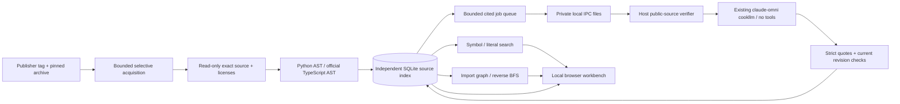

# Architecture

One application process owns one SQLite database on a project-specific named Docker volume. Original source and licenses are read-only container mounts. IPC is the only shared writable host directory. The host PID/lock/log/durable inference ledger is a separate **unmounted** control directory. The application has no credentials, model CLI, Docker socket, source execution or arbitrary ingestion route. A fixed trusted Node24 parser subprocess receives source over bounded JSON stdin with a credential-free environment, 8-second timeout and160MiB V8 heap bound; it only calls TypeScript createSourceFile. It has no CompilerHost/module resolution/emit/eval path. The container filesystem remains read-only. Normal Docker bridge networking is used with one loopback-only published port; this local Docker engine did not support published loopback ports correctly on internal networks in earlier verification. No claim of complete egress sandboxing follows from the bind address.

The graph is a module import graph, not a call graph. Edges retain exact import statement evidence and type-only status. Reverse BFS returns shortest bounded paths from possible consumers to the changed module; runtime reachability and change semantics remain unknown. Excluded source, unresolved imports, external packages, dynamic imports and parse failures must remain visible.

Source indexing stages validated bytes and commits all new files/definitions/imports together. No-op scans preserve revision and citations. A changed index invalidates old question/context/answer evidence while retaining lifetime attempt accounting. Invalid source must preserve the last good index. Source pages and citations use physical one-based line numbers, exact original bytes and pinned publisher revisions.

AI explanations use at most four bounded source excerpts, not an arbitrary repository agent. The host independently matches each excerpt to its pinned public source file and line range before any inference. It exposes no execution tools. Claims require exact quote support; the server computes citation lines and rejects stale/current-hash mismatches. Exact quote validation verifies provenance, not semantic truth; human/source checks assess each live claim in the verification report. Prompt injection is treated as data and tested separately. Model requests are explicit, bounded, persisted before publication and never automatically retried. A timeout/crash can consume an attempt; already-started inference cannot be uncharged by deleting a request.

SQLite and IPC files have distinct durability boundaries; queue transitions commit before cleanup. On restart, completed valid responses are consumed and intact pending files retain their original IDs. Missing/invalid/expired requests fail. No request is republished and the host durable ledger prevents inference replay. This local single-process design deliberately avoids distributed workers and shared infrastructure. Independent projects share no runtime code, database, volume or mutable state.
