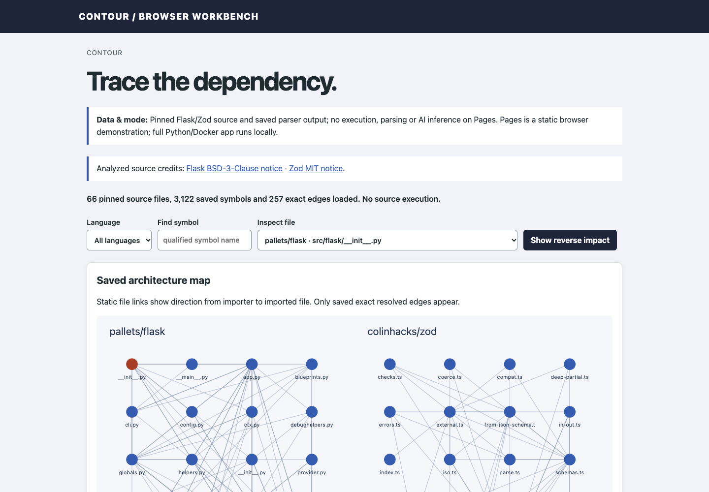

# Contour — AI codebase explorer

**[Open the GitHub Pages browser demo](https://skuraganti.github.io/ai-codebase-explorer/)** · [Architecture](ARCHITECTURE.md) · [Data sources](DATA_SOURCES.md) · [Verification](VERIFICATION.md) · [Public roadmap](https://github.com/users/skuraganti/projects/5)

Contour is a local, source-only workbench for understanding an unfamiliar Python or TypeScript codebase before changing it. It parses pinned source into searchable definitions and a module import graph, and definition and citation records retain exact physical-line ranges. Analyzed code is never executed, built or installed.



## Full local application workflow

1. **Find a definition.** In Flask, search `Flask.dispatch_request`. Compare symbol-aware search with literal source-line search for the same name.
2. **Open the exact lines.** The result opens the definition's inclusive, 1-based physical line range in the pinned original file.
3. **Follow import edges.** In the module atlas, each arrow points from the importer to the module it imports. Select a module to inspect its recorded import statements and physical lines; the local app can filter type-only imports.
4. **Find potential consumers.** Select a module you plan to change and run change impact. A reverse breadth-first search (1 to 5 hops, default 3) returns one discovered shortest path per reachable module that directly or transitively imports it.

A reverse-impact path is *potential static reachability*. It does not show runtime breakage, call relationships or change semantics. Unresolved, dynamic, external and outside-sample imports stay visible instead of being guessed.

## How parsing works

- **Python** uses the standard-library `ast` module.
- **TypeScript** uses the official TypeScript 6.0.3 compiler API (Apache-2.0, vendored with its notices) in a trusted Node subprocess (the Docker image pins Node 24). It creates an in-memory AST with `createSourceFile` and walks it, without a compiler host, TypeScript module resolution, emit or evaluation. Input goes over bounded stdin, with an 8-second subprocess timeout and a 160 MiB V8 old-space limit; this is not a total-process memory cap.
- **No execution of the analyzed repositories.** No build, test, install or package script from them is run.

A native tree-sitter parser was tried first and failed. Real Zod files crashed it (exit 139) or produced false syntax diagnostics. Replacing it with the official compiler API let all 42 selected TypeScript files parse with zero diagnostics. The failure is recorded in [DECISIONS.md](DECISIONS.md).

An unchanged rescan keeps existing citations. Path, manifest and checksum validation failures preserve the current index. A validated changed snapshot commits atomically; parser failures remain visible as error files with diagnostics rather than guessed definitions ([ARCHITECTURE.md](ARCHITECTURE.md)).

## Corpus and graph

The corpus is 66 real source files from two pinned, permissively licensed libraries:

- **Flask 3.1.3:** 24 Python files under `src/flask/` (BSD-3-Clause)
- **Zod 4.6.7:** 42 TypeScript files under `packages/zod/src/v4/{core,classic,mini}` (MIT)

The saved graph has **257 distinct directed, resolved file-to-file edges**. That counts unique importer → imported pairs, not import statements, and it is not a call graph. This is a bounded architecture sample, not the full packages. For example, a Zod re-export into `locales` is marked *outside_sample*, not broken. Commits, archive hashes and selection rules are in [DATA_SOURCES.md](DATA_SOURCES.md).

## Pages demo vs. full application

| | Pages demo | Full local app |
|---|---|---|
| Parsing | None. Displays saved Python AST and TypeScript compiler output ([fixture and checksum](PUBLIC_DEMO_DATA.md)) | Indexes the pinned corpus locally |
| Search, graph, impact | Saved-name symbol search, the full edge table and reverse BFS over saved resolved edges (up to 100 paths; no hop/type controls) | Literal source search, rescans, persistence, type-only import filtering and impact depth 1–5 |
| Explanations | Not available | Optional cited explanations through the existing authorized host bridge |

The Pages renderer includes all 66 saved files and 257 directed pairs; the viewport may show only part of the diagram. Selecting a Pages symbol opens its file rather than highlighting an exact definition range. Walkthroughs: [docs/DEMO.md](docs/DEMO.md) (Pages) and [DEMO.md](DEMO.md) (local).

## Recorded evaluation

- **Search.** Twelve frozen source-location tasks (four development, eight held out) compare symbol-aware search with a literal source-line baseline, using the same queries and scope. This is a small, hand-selected set that includes a no-match task. It is not a representative benchmark.
- **Live explanations.** Four frozen model checks were recorded: one development explanation, two held-out explanations and one synthetic prompt-injection / unknown-answer probe. The synthetic probe is reported separately from the real-source tasks. The recorded summary reports **one unqualified real-source pass**, **one synthetic abstention pass**, **one qualified real-source explanation** (incomplete citations) and **one real-source quote-validation rejection**. Each condition has n=1. An additional browser repeat was separate from this four-task set, making five recorded application calls overall. There was no automatic retry; the documented protocol kept held-out cases out of tuning.

Exact quote matching proves where a citation came from, not that each statement is correct. These outcomes are retained recorded summaries, not a fresh raw-response regrade. No fresh model runs were made for this README; actual monetary billing for the recorded calls is unavailable.

## Run locally

Requirements: a POSIX host (macOS or Linux), Python 3.13+, [uv](https://docs.astral.sh/uv/), and Docker with Compose. Running the native tests also needs **Node 24+** on `PATH` for the TypeScript parser; the Docker image already includes Node. No GPU is needed.

```sh
uv sync --frozen
uv run python scripts/bootstrap.py
sh stack.sh up
```

Bootstrap verifies the hashes of the bundled corpus in `examples/corpus/` and copies it to the Git-excluded `data/corpus/`, without any network acquisition. To re-acquire the sources from GitHub, run `uv run python scripts/acquire.py --output-dir data/reproduction`. It fails if a tag no longer resolves to its recorded commit.

Check `sh stack.sh status` and wait for healthy, then open **http://127.0.0.1:8284**. `sh stack.sh stop` stops the app and any bridge, and keeps local state. You can also run `sh stack.sh status` or `sh stack.sh logs`. The defaults work without copying `.env.example`, which documents `CONTOUR_PORT`, `CONTOUR_UID`, `CONTOUR_DB`, `CONTOUR_SOURCE` and `CONTOUR_BRIDGE`. The stack binds only to 127.0.0.1.

**Optional bridge.** Search, the graph and impact analysis need no model. On a host already configured for the existing authorized `claude-omni` / `cookllm` route (with `zsh`), `sh stack.sh bridge` enables explanations. Each request sends the entered question and at most four excerpts, which the host re-checks against the pinned public files. Keep private content out of the question. The model has no tools, and each claim must cite an exact quote. Inference may run remotely. The repository includes no credentials or fallback provider. The persistent app allows ten lifetime job reservations and at most three pending jobs; the separate durable host ledger permits up to ten inference attempts and records before invocation. Failures and timeouts can consume attempts, with no automatic retry. `scripts/evaluate_live.py` makes no calls unless you pass `--live`.

## Verify

```sh
uv run pytest
uv run ruff check .
python3 -m http.server 8008 --bind 127.0.0.1 --directory docs
```

These commands make no model calls; native tests use simulated model responses. The recorded release suite passed 53 native tests; those tests were not rerun for this documentation edit. The last command previews Pages at http://127.0.0.1:8008; leave it running. In a second terminal, with agent-browser 0.38.1 installed, `sh scripts/check-pages.sh http://127.0.0.1:8008` runs `tests/pages-smoke.js`. Release checks and their limits are in [VERIFICATION.md](VERIFICATION.md).

## Scope and limitations

Static imports miss runtime conditionals, plugin loading, dynamic dispatch and type inference. Results reflect two libraries and imply nothing about general parser accuracy. Contour is a single-user localhost tool with no authentication. It never edits code or applies patches.

## Sources, attribution and license

The analyzed code belongs to Pallets and the Flask contributors (BSD-3-Clause) and to Colin McDonnell and the Zod contributors (MIT). Their notices are kept with the corpus and Pages (`docs/flask-LICENSE.txt`, `docs/zod-LICENSE`), and no endorsement is implied. TypeScript (Apache-2.0) and Cytoscape.js (MIT) are vendored with their licenses. The original implementation was developed with Claude Code, with architecture, integration, review, correction and independent verification by ChatGPT. Upstream work is credited in [UPSTREAM.md](UPSTREAM.md), and source versions are in [SOURCE_MANIFEST.json](SOURCE_MANIFEST.json). Third-party licenses remain in force. No additional license grant for the original implementation has been selected.
